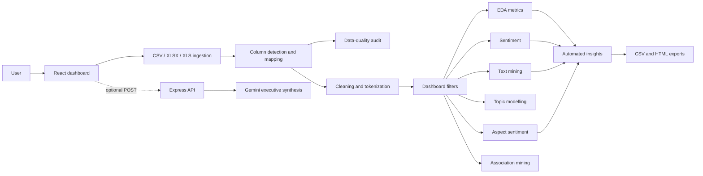

# Universal Review Mining & Intelligence System

**Project type:** Client-side business-intelligence and review-analytics dashboard with an optional Gemini-powered executive summary API.  
**Primary language:** TypeScript.  
**UI framework:** React 19 with Vite and Tailwind CSS 4.  
**Server runtime:** Node.js, Express, and TypeScript.  
**Current version in package metadata:** `0.0.0` (private project).

## 1. Purpose

The Universal Review Mining & Intelligence System lets a user upload a customer-review dataset and turn it into an interactive analytics dashboard. It detects likely column meanings, cleans and normalizes review text, runs data-quality checks, calculates sentiment and text-mining metrics, discovers domain-oriented topics and aspects, mines word associations, and produces downloadable cleaned data and an HTML intelligence report.

The product is designed for review datasets from multiple domains, such as products, hotels, restaurants, and services. It ships with mobile-device, hospitality, and restaurant sample datasets.

## 2. What the application does

1. Accepts CSV, XLSX, and XLS review files in the browser.
2. Loads sample datasets for immediate exploration.
3. Automatically detects review, rating, product, date, category, and price columns.
4. Lets the user override every detected column mapping.
5. Audits missing data, duplicates, inferred types, unique values, and approximate memory use.
6. Cleans review text and creates reusable NLP tokens.
7. Applies lexicon- and rating-assisted sentiment classification.
8. Provides exploratory analysis, product/category comparisons, filters, KPI cards, and Plotly charts.
9. Extracts frequent words, sentiment words, n-grams, TF-IDF-like scores, and word-cloud values.
10. Detects seeded topics and customer-experience aspects.
11. Mines single/pair word itemsets and association rules.
12. Generates deterministic data-backed insight statements.
13. Downloads cleaned CSV data and an HTML intelligence report.
14. Optionally calls Gemini from the Express API to produce an executive synthesis.
15. Includes a Python/Streamlit starter-code exporter in the UI; this is embedded reference code, not the application runtime.

## 3. Technology stack

| Area | Technology | How it is used |
|---|---|---|
| Front end | TypeScript, React 19, React DOM | Dashboard, state management, reusable components, client-side analytics orchestration. |
| Build tooling | Vite 6, `@vitejs/plugin-react`, esbuild, tsx | Development server, React transform, production web build, and server bundling. |
| Styling | Tailwind CSS 4, `@tailwindcss/vite`, custom CSS | Responsive dashboard layout, tabs, filter sidebar, cards, tables, and visual states. |
| Charts | Plotly.js, `react-plotly.js` | Interactive EDA, rating/sentiment, and dashboard visualizations. |
| File ingestion | Papa Parse, SheetJS (`xlsx`) | Browser parsing of CSV and Excel (`.xlsx`, `.xls`) files. |
| Icons | Lucide React | Navigation, KPI, action, and status icons. |
| Animation | Motion | Available UI-animation dependency. |
| API/server | Node.js, Express 4, dotenv | Health endpoint, Gemini synthesis endpoint, development Vite middleware, and production static serving. |
| Generative AI | `@google/genai` | Server-side Gemini executive-summary generation when `GEMINI_API_KEY` is available. |
| Optional exported reference | Python, Streamlit, Pandas, NLTK, scikit-learn, Plotly, MLxtend | A downloadable/reference Python implementation displayed by the Python Exporter section. |

## 4. Architecture



### Execution model

- Most analysis is fully client-side. The React app stores the raw dataset, mapping, cleaning options, filter state, and derived analytics in memory.
- React `useMemo` recalculates outputs when a data, configuration, or filter dependency changes.
- No database, authentication, persistent user storage, background job system, or external analytics service is implemented.
- The only server-side AI feature is `POST /api/gemini/summarize`; it needs `GEMINI_API_KEY` in the environment. The key never belongs in browser code.

## 5. End-to-end data flow

| Stage | Input | Main implementation | Output |
|---|---|---|---|
| Dataset selection | Sample ID or browser file | `src/modules/dataLoader.ts` | Rows, columns, file metadata. |
| Schema understanding | Rows and columns | `src/modules/columnDetector.ts` | Candidate mappings with confidence, example values, type, and distinct-count metadata. |
| Data quality | Raw rows and selected mapping | `src/modules/dataQuality.ts` | Row/column counts, missing/duplicate metrics, inferred data types, memory estimate. |
| Cleaning | Raw rows, mapping, configuration | `src/modules/dataCleaner.ts` + `textPreprocessing.ts` | `CleanedReviewRow` records and cleaning metrics. |
| Filtering | Cleaned rows and UI filter state | `src/App.tsx` | The active subset used by all downstream calculations. |
| Analytics | Filtered cleaned rows | EDA, sentiment, text mining, topics, aspects, association, insights modules | Typed results rendered by tabs and sections. |
| Export | Results and active subset | `src/modules/reportGenerator.ts` | Browser-downloaded cleaned CSV and self-contained HTML report. |

## 6. Core data model

The app uses TypeScript interfaces in `src/types.ts`, which is the shared contract between the UI and analysis modules.

| Type | Important fields | Role |
|---|---|---|
| `DatasetRow` | Dynamic key/value record | Raw row after parsing. |
| `ColumnMapping` | review, rating, product, date, category, price column names | User-approved interpretation of the uploaded schema. |
| `CleaningConfig` | missing/duplicate removal, HTML/URL/punctuation handling, lowercase, minimum length, custom stopwords | Makes preprocessing adjustable. |
| `CleanedReviewRow` | original and cleaned text, tokens, rating, product, category, date, price, sentiment, score | Canonical analysis-ready review record. |
| `DataQualityReport` | data dimensions, missing/duplicate statistics, types, memory estimate | Data-health summary. |
| `EDAMetrics` | rating/product/category/time/length distributions and scatter data | Dashboard analysis payload. |
| `SentimentAnalysisResult` | counts, percentages, mean score, matrix metrics, annotated rows | Sentiment summary and evaluation. |
| `TextMiningResult` | word, n-gram, TF-IDF, and word-cloud data | NLP/text-analysis payload. |
| `TopicInfo`, `AspectSentimentItem`, `AssociationRule`, `AutomatedInsight` | Topic/aspect/rule/insight structures | Specialized analysis results. |

## 7. Modules and algorithms

### 7.1 File loading — `src/modules/dataLoader.ts`

- Loads any included sample dataset by ID.
- Parses CSV with Papa Parse using headers, greedy empty-line skipping, and dynamic typing.
- Parses Excel by reading the first worksheet with SheetJS and converting it to JSON rows.
- Supports `.csv`, `.xlsx`, and `.xls` only.
- Returns file name, rounded size in KB, data, rows, dimensions, headers, and readable error messages.

### 7.2 Column detection — `src/modules/columnDetector.ts`

The detector samples up to 50 rows and calculates per-column average string length, sample values, distinct count, numeric coverage/range, and date-likeness. It then searches for keyword patterns and applies fallbacks:

| Semantic field | Examples of recognized names | Fallback |
|---|---|---|
| Review text | `review`, `comment`, `feedback`, `description`, `content` | Longest non-numeric text column with average length above 15. |
| Rating | `rating`, `score`, `stars`, `grade`, `points` | Numeric column in 0–10 range with at most 10 distinct values. |
| Product | `product`, `item`, `brand`, `model`, `dish_name`, `hotel_name` | No non-keyword fallback. |
| Date | `date`, `timestamp`, `time`, `created_at` | A column with at least 60% parseable/date-shaped values. |
| Category | `category`, `type`, `department`, `genre`, `segment` | No non-keyword fallback. |
| Price | `price`, `cost`, `amount`, `msrp`, `value` | No non-keyword fallback. |

The result includes high/medium confidence and remains editable in the Dataset & Ingestion screen.

### 7.3 Data quality — `src/modules/dataQuality.ts`

- Counts all missing/blank cells and their percentage of all cells.
- Counts duplicate complete rows using serialized row equality.
- Infers basic types: number when at least 80% of non-null values are numeric; categorical for low-cardinality columns; date when the column name contains `date` or `time`; otherwise text.
- Reports non-null, null, and unique counts per column.
- Estimates memory by JSON string length. This is an approximate display metric, not a precise browser memory profile.

### 7.4 Cleaning and preprocessing — `dataCleaner.ts` and `textPreprocessing.ts`

Default cleaning removes missing reviews and case-insensitive duplicate original text, strips HTML and URLs, lowercases text, removes non-alphanumeric characters, collapses whitespace, filters stopwords/numeric/single-character tokens, and applies a lightweight suffix-based lemmatizer. Custom comma- or whitespace-separated stopwords are merged with the built-in English stopword list.

The pipeline also:

- Discards reviews shorter than the configured minimum length (five characters by default) or that become empty after cleaning.
- Parses ratings from 0–10 and converts values above five to an approximate five-star score by halving and rounding.
- Parses numeric price values.
- Carries mapped product, category, and date values into the canonical row.
- Computes initial sentiment label and score for each cleaned review.

### 7.5 Sentiment analysis — `src/modules/sentimentEngine.ts`

The current method is an explainable, rule-based classifier rather than a trained machine-learning model:

- Matches tokens against curated positive and negative word sets.
- Applies a multiplier when an immediately preceding token is an intensifier.
- Reverses polarity when an immediately preceding token is a negation.
- Normalizes the lexical score to the -1 to +1 range.
- If a rating exists, blends 70% lexical score and 30% normalized star rating.
- Labels scores greater than `0.15` positive, below `-0.15` negative, otherwise neutral.
- Produces a rating-versus-sentiment matrix and flags direct contradictions such as a five-star review with negative sentiment.

When ratings exist, it also reports confusion-matrix-style metrics based on the heuristic assumption that ratings 4–5 are positive ground truth. These are diagnostic heuristic alignment metrics, not a validated model benchmark.

### 7.6 Exploratory data analysis — `src/modules/edaEngine.ts`

The EDA engine calculates total reviews, average rating, distinct products/categories, rating distribution, top product counts, average rating by product, category distribution, monthly timeline count, review-length buckets, top products, and limited scatter datasets for rating versus review length/price. Several chart payloads intentionally cap plotted records or categories for a readable dashboard.

### 7.7 Text mining — `src/modules/textMiningEngine.ts`

- Counts words across all cleaned tokens.
- Separately counts terms in positive and negative reviews.
- Builds bigram and trigram frequencies from adjacent tokens.
- Calculates a lightweight corpus-level TF-IDF-like score: global term frequency multiplied by smoothed inverse document frequency.
- Produces color-tagged values for all, positive, and negative word clouds.

### 7.8 Topic modeling — `src/modules/topicModelingEngine.ts`

Despite the UI label mentioning topic modeling, this browser implementation is a seeded-cluster heuristic, not a statistical LDA implementation. It checks document-level occurrence of domain keyword clusters—such as Performance & Hardware, Camera & Optics, Food & Culinary Taste, Service & Staff, and Price & Value—ranks matched clusters by frequency, and returns up to four topics. If no seed cluster matches, it divides the top document-frequency terms into fallback groups.

### 7.9 Aspect sentiment — `src/modules/aspectSentimentEngine.ts`

The aspect analyzer has a fixed multi-domain vocabulary across battery/power, camera/video, display, performance, build, value, food, staff, room/hygiene, audio, and delivery. A review can match more than one aspect. For each matching aspect it accumulates positive, negative, neutral counts and retains up to two representative positive and negative reviews.

### 7.10 Association mining — `src/modules/associationMiningEngine.ts`

Each review becomes a transaction containing unique tokens. The engine:

1. Counts frequent one-word itemsets.
2. Counts candidate two-word itemsets.
3. Enforces minimum support of `max(2, ceil(number_of_reviews × 0.05))` by default.
4. Generates both directional rules for pairs meeting a minimum confidence of 0.4.
5. Calculates support, confidence, lift, and a human-readable explanation.
6. Returns the top 15 rules by lift.

It is a lightweight in-browser pairwise implementation; it does not enumerate higher-order itemsets or run a full Apriori/FP-Growth library.

### 7.11 Automated insights — `src/modules/insightsEngine.ts`

The insight engine creates deterministic statements from calculated results. It can identify overall satisfaction/friction, the strongest praise aspect, complaint-heavy aspect, highest-rated product, highest complaint-volume product, and the most frequent bigram. These insights are based on current filters, so they change as the user adjusts the dashboard.

### 7.12 Report generation — `src/modules/reportGenerator.ts`

- `generateCleanedCSV` returns a properly quote-escaped CSV containing normalized columns including original text, clean text, rating, sentiment, product, category, date, and price.
- `generateHTMLReport` returns a self-contained, styled HTML report with data-quality metrics, executive KPIs, insights, aspect breakdown, and discovered topics.

## 8. User-interface modules

| Module | Responsibility |
|---|---|
| `src/App.tsx` | Central orchestration: data state, mapping, cleaning setup, filters, all memoized analytics, tab routing, and downloads. |
| `Navbar.tsx` | Sticky dashboard header, dataset summary, sample reset, and 12 application tabs. |
| `SidebarFilters.tsx` | Collapsible filter pane for product, category, rating, sentiment, date, price, review length, topics, and aspects. |
| `FileUploadSection.tsx` | File upload, sample selection, ingestion status, and errors. |
| `ColumnDetectionSection.tsx` | Shows automatic schema-detection results and lets users update mappings. |
| `DataCleanerSection.tsx` | Configures text-cleaning rules and shows cleaning results. |
| `DataQualitySection.tsx` | Renders dataset health and inferred column-profile information. |
| `KPICardsGrid.tsx` | Displays up to 20 executive metrics with a collapse-to-eight option. |
| `EDADashboard.tsx` / `EDARatingTab.tsx` | Displays rating, product, category, time, length, and comparison charts. |
| `SentimentSection.tsx` / `RatingSentimentSection.tsx` / `SentimentTab.tsx` | Displays sentiment distribution, score summaries, rating alignment, and mismatches. |
| `TextMiningSection.tsx` / `TextAnalysisTab.tsx` | Displays frequent terms, n-grams, TF-IDF-style values, and word-cloud payloads. |
| `TopicModelingSection.tsx` / `TopicModelingTab.tsx` | Displays discovered topics, weights, keywords, and sample reviews. |
| `AspectSentimentSection.tsx` / `ProductAspectTab.tsx` | Displays aspect sentiment and product-focused comparisons. |
| `AssociationMiningSection.tsx` / `DataMiningTab.tsx` | Displays frequent itemsets and association rules. |
| `InsightsSection.tsx` | Renders automated intelligence cards and optional AI-facing synthesis content. |
| `TablesDownloadsTab.tsx` | Provides review tables and CSV/HTML download actions. |
| `PythonExporterSection.tsx` | Displays/export-oriented reference files for a separate Streamlit/Python variant. |
| `PlotlyChart.tsx` | Shared Plotly chart wrapper. |

## 9. Dashboard tabs and key features

| Tab | Main capabilities |
|---|---|
| Dataset & Ingestion | Upload file, select samples, view source metadata, verify/override auto-detected columns. |
| Overview | High-level review, rating, sentiment, and product KPIs. |
| Data Quality | Missing data, duplicates, inferred column types, unique counts, and estimated memory. |
| EDA | Rating distributions, product/category volume, average ratings, time trends, length distribution, and scatter plots. |
| Sentiment | Positive/neutral/negative results, sentiment score, rating comparison, and mismatch detection. |
| Text Mining | Frequent words, positive/negative language, n-grams, TF-IDF-like weighting, and word-cloud data. |
| Data Mining | Frequent token itemsets and directional association rules with support, confidence, and lift. |
| Topic Modeling | Seeded topic clusters, keyword weights, and example review text. |
| Product Comparison | Cross-product and aspect-oriented analysis. |
| Insights | Automatically generated factual insight cards; Gemini endpoint is available for optional executive text synthesis. |
| Downloads | Review tables, cleaned-data CSV, and HTML intelligence-report download. |
| Python Exporter | Reference Python/Streamlit codebase content. |

## 10. API contract

### `GET /api/health`

Returns a basic service-status JSON payload:

```json
{
  "status": "ok",
  "service": "Universal Review Mining & Intelligence API"
}
```

### `POST /api/gemini/summarize`

This optional endpoint uses the configured Gemini API key to create an Executive Intelligence Brief.

Expected request body:

```json
{
  "metrics": {
    "totalReviews": 100,
    "avgRating": 4.2,
    "positiveCount": 70,
    "positivePct": 70,
    "negativeCount": 15,
    "negativePct": 15,
    "aspects": [],
    "topKeywords": []
  },
  "sampleReviews": [
    { "rating": 5, "sentiment": "positive", "text": "Excellent product." }
  ],
  "domainName": "Consumer electronics"
}
```

Response: `{ "summary": "..." }`. If `GEMINI_API_KEY` is not set, the endpoint returns HTTP 400; failed model calls return HTTP 500.

## 11. Project structure

```text
.
├── index.html                  # Vite HTML entry point
├── package.json                # Scripts and JavaScript/TypeScript dependencies
├── server.ts                   # Express server and Gemini endpoint
├── vite.config.ts              # Vite, React, Tailwind, alias, and HMR configuration
├── tsconfig.json               # TypeScript configuration
├── metadata.json               # AI Studio application metadata
├── src/
│   ├── main.tsx                # React bootstrap
│   ├── App.tsx                 # Application state and pipeline orchestration
│   ├── index.css               # Global styles
│   ├── types.ts                # Shared TypeScript contracts
│   ├── data/
│   │   ├── sampleDatasets.ts   # Built-in mobile, hotel, and restaurant datasets
│   │   └── pythonCodebase.ts   # Python/Streamlit reference-code content
│   ├── modules/                # File, quality, cleaning, NLP, analytics, export engines
│   └── components/             # Dashboard UI sections, charts, filters, and tabs
└── PROJECT_DOCUMENTATION.md    # This technical project guide
```

## 12. Installation, configuration, and commands

### Prerequisites

- Node.js compatible with the dependency set.
- npm or Bun-compatible package manager.
- A Gemini API key only if using the executive synthesis endpoint.

### Setup

```bash
npm install
```

Create a local environment file for the optional server-side AI feature:

```env
GEMINI_API_KEY=your_key_here
```

### Commands

| Command | Purpose |
|---|---|
| `npm run dev` | Starts `tsx server.ts`; Express runs on port 3000 and uses Vite middleware in development. |
| `npm run build` | Builds the Vite client and bundles `server.ts` to `dist/server.cjs`. |
| `npm start` | Starts `dist/server.cjs` after a production build. |
| `npm run preview` | Runs Vite's static preview server. |
| `npm run lint` | Runs TypeScript type checking with `tsc --noEmit`. |

### Production behavior

When `NODE_ENV=production`, Express serves static files from `dist` and routes unmatched paths to `dist/index.html` for SPA navigation. In development, it attaches Vite in middleware mode.

## 13. Input expectations and output artifacts

### Recommended input columns

Only a text/review column is essential. Rating, product, date, category, and price are optional, but they enable more EDA, filtering, and comparison features. For best automatic detection, use clear header names such as `review`, `rating`, `product_name`, `date`, `category`, and `price`.

### Output artifacts

- **In-dashboard interactive views:** KPI cards, charts, tables, detected schema, topics, aspects, rules, and insights.
- **Cleaned CSV:** Includes canonical review fields and calculated sentiment fields for the active filtered subset.
- **HTML intelligence report:** A self-contained report downloaded in the browser.
- **Gemini executive brief:** Returned from the optional API rather than stored by the system.

## 14. Security, privacy, and operational notes

- Uploaded data is parsed and analyzed in the browser by default; this is beneficial for privacy but browser memory limits apply to large files.
- The Gemini endpoint sends supplied metrics and sample reviews to Google only when it is explicitly used. Avoid sending sensitive review content without an appropriate data-sharing policy.
- Keep `GEMINI_API_KEY` in server environment configuration and never embed it in React source, checked-in files, or a client `.env` that Vite exposes.
- There is no authentication, authorization, tenant isolation, encrypted persistence, audit log, database, or rate limiting in the checked-in source.
- The server accepts JSON bodies up to 50 MB. Deployment should add request validation, rate limiting, error monitoring, HTTPS, and secrets management.

## 15. Current limitations and important implementation notes

1. **Sentiment is lexicon-based.** It is explainable and fast, but it is not equivalent to a trained transformer or domain-tuned classifier; sarcasm, negation chains, and domain terminology can be misclassified.
2. **Topic modeling is seeded clustering.** The UI and Python reference mention LDA, but the TypeScript app does not run a probabilistic LDA model.
3. **Association mining is pairwise.** It supports one- and two-token itemsets, not arbitrary-length frequent itemsets.
4. **Topic and aspect filters are present in the sidebar state/UI, but the central `filteredRows` predicate currently applies product, category, rating, sentiment, date, maximum price, and maximum review length only. Topic/aspect selections do not currently restrict rows; the minimum-price control is also not applied in that predicate.
5. **Date filters compare string values.** ISO-style dates (`YYYY-MM-DD`) are the safest input format for correct chronological filtering.
6. **Excel loading uses the first worksheet only.** There is no worksheet picker.
7. **Client-side analysis has no persistence.** A page refresh clears uploaded data and active settings.
8. **The dependency `motion` is installed but not used by the inspected source files.**
9. **Some KPI fallback values are display defaults.** When data is unavailable, a few card calculations show illustrative defaults rather than strict `N/A`; this should be reviewed before using the dashboard for formal reporting.
10. **The Python code is reference/export content.** It is not executed by this React/Express application and may differ from the TypeScript implementation.

## 16. Suggested future improvements

- Replace fixed lexicons and seeded topics with configurable, evaluated NLP/ML pipelines.
- Add multilingual text handling, language detection, richer lemmatization, and configurable domain vocabularies.
- Implement true filter semantics for minimum price, topics, and aspects.
- Add dataset schema validation, configurable Excel worksheet selection, and clearer parse warnings.
- Support persistent projects, export history, user authentication, and role-based access.
- Add tests for analytics modules, API contract tests, and end-to-end upload/export tests.
- Add API input validation, rate limiting, observability, and production secret-management guidance.
- Add accessibility checks for charts, keyboard flows, color contrast, and downloadable alternatives.
- Add automated model-quality evaluation against labeled datasets before presenting classifier metrics as performance claims.

## 17. Summary

This project is a TypeScript/React review-analysis dashboard that combines browser-side ingestion, configurable cleaning, explainable NLP heuristics, exploratory analytics, association rules, aspect/topic summaries, and exportable business-intelligence reports. Express supplies a small health/API layer and an optional server-side Gemini executive-summary feature. Its greatest strengths are its transparent pipeline and broad dashboard coverage; its next technical step should be stronger data validation and production-grade, evaluated NLP methods.
